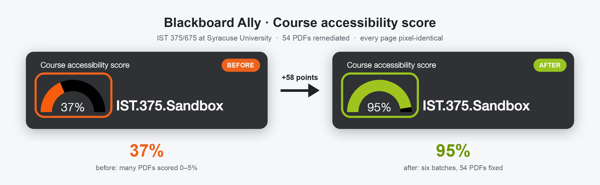

# PDF Accessibility Fixer

A Claude Code skill that makes PDFs accessible for screen readers and checkers like Blackboard Ally, without changing how any page looks.

<p align="center">
  
</p>

It adds only the invisible accessibility layer: tags, reading order, headings, alt text, title and language. The original layout stays pixel-identical, so page numbers and citations don't change.

## Install

```bash
git clone https://github.com/naimbh/pdf-accessibility-fixer ~/.claude/skills/pdf-accessibility-fixer
cd ~/.claude/skills/pdf-accessibility-fixer
python3.14 -m venv .venv && .venv/bin/python -m pip install -r requirements.txt
brew install ocrmypdf   # only needed for scanned PDFs
```

Needs Python 3.10–3.14.

## Use

Attach your PDFs in Claude Code and ask:

> Use the pdf-accessibility-fixer skill to make these PDFs accessible.

Fixed copies are saved to a separate folder. Originals are never changed.

## What it handles

- **Tagged PDFs** from Word, PowerPoint or InDesign: repairs headings and alt text
- **Untagged PDFs**: adds full tags in place
- **Scanned PDFs**: adds an invisible OCR text layer
- **Text without word spaces**: adds spaced text for screen readers
- **Metadata**: sets the title and language, and removes tool names

Every file is verified before it is handed over. If any page differs from the original by a single pixel, it fails.

## Works with

Tested with Blackboard Ally. Other checkers test the same PDF properties, including Ally in Canvas, Moodle and Brightspace, UDOIT, Brickfield, Adobe Acrobat and PAC, but results there have not been measured yet.

## Limitations

- A table that runs across pages is tagged as one table per page.
- OCR on curled or faint scans can contain errors.

See [SKILL.md](SKILL.md) for the full workflow.

## License

MIT
